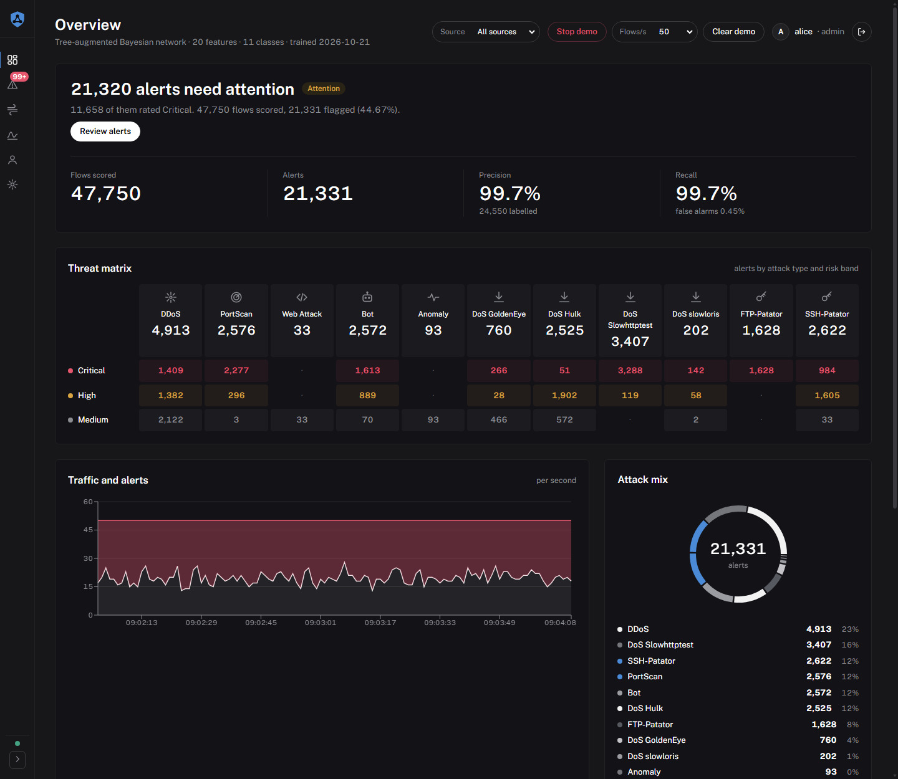
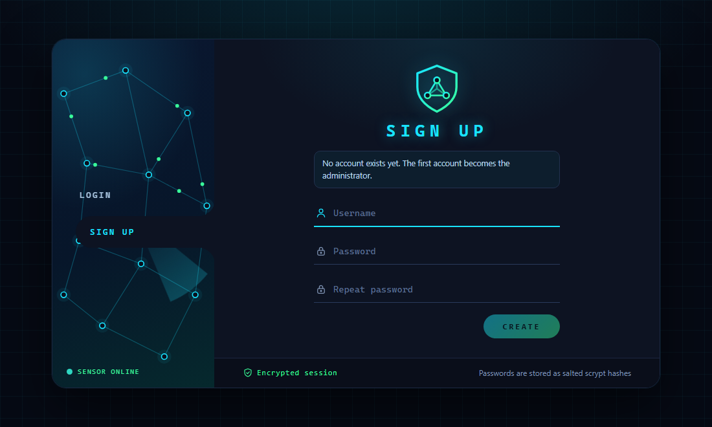
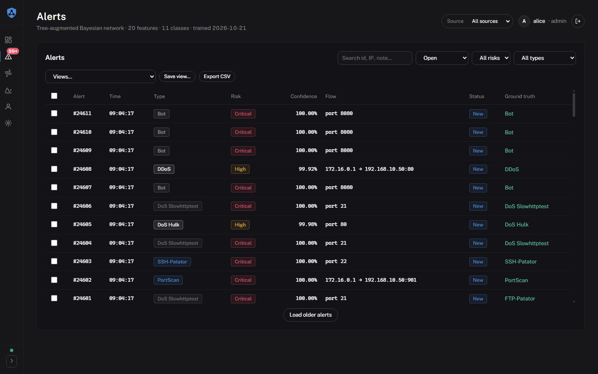
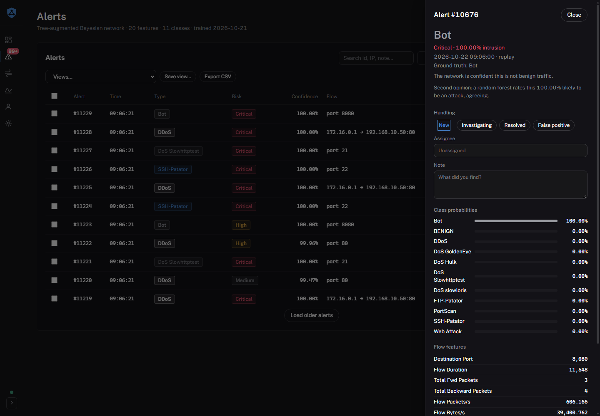
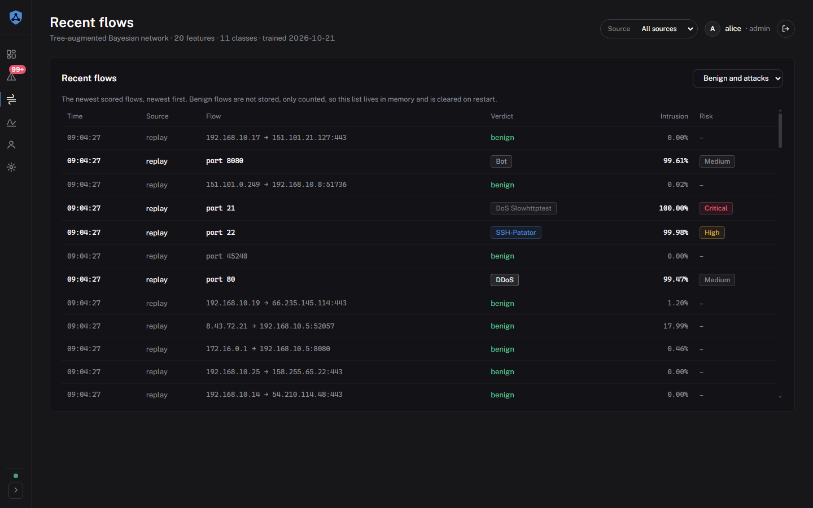
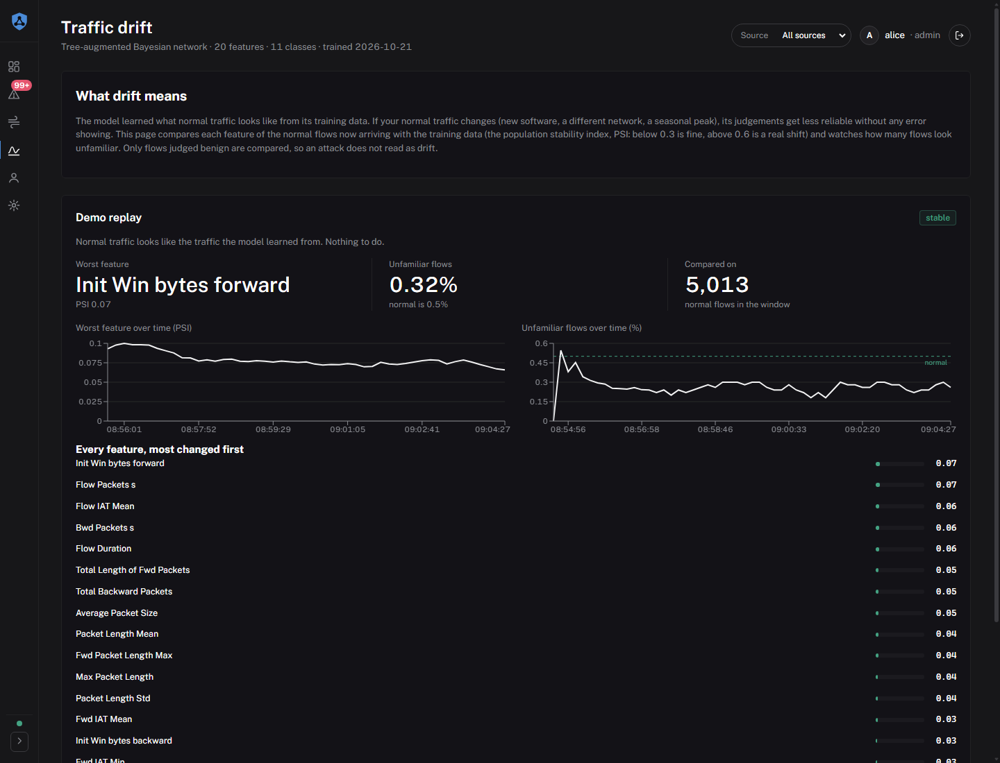
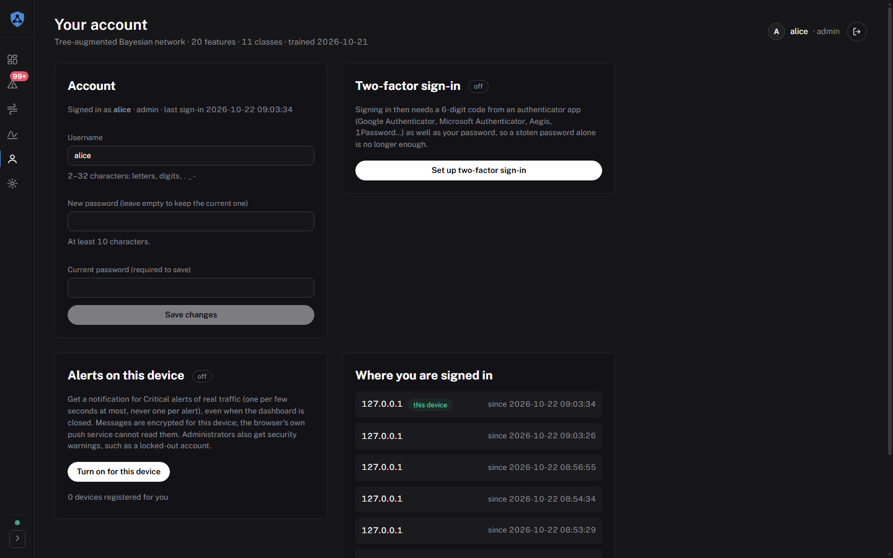
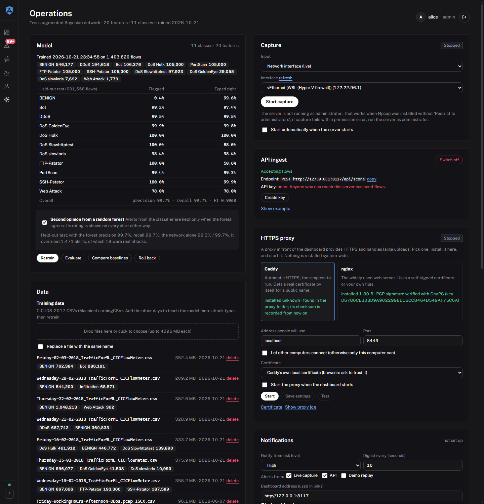
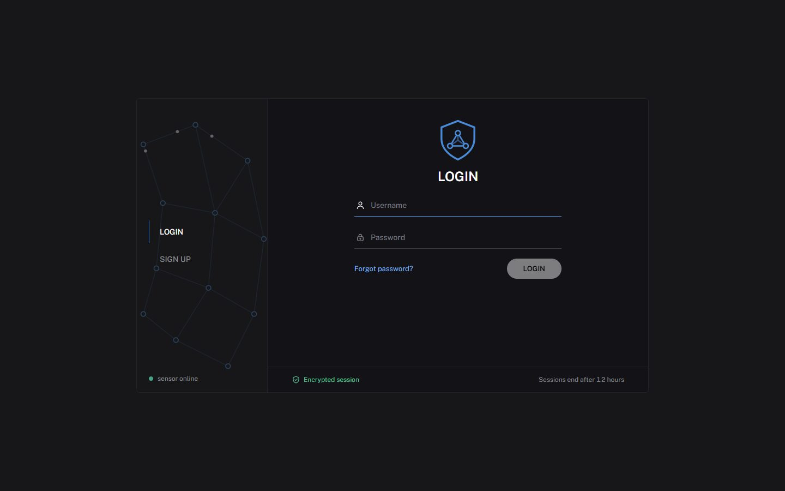
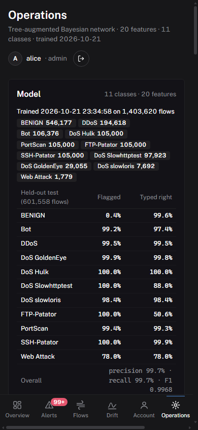

# Bayesian IDS

A network intrusion detection system built on a **Bayesian network**, trained on CIC-IDS-2017
flows. It scores network flows, raises alerts with a handling workflow, watches for traffic drift
and sends notifications. It runs on live packet captures, pcap files and flow CSVs from a flow
exporter, and **everything is operated from a web dashboard**: training, uploads, capture,
notifications, accounts, HTTPS and even putting it online.



**Contents**
[Quick start](#quick-start) ·
[Tour](#a-tour-of-the-dashboard) ·
[How it fits together](#how-it-fits-together) ·
[Accounts and roles](#accounts-and-roles) ·
[Operations](#operations-everything-an-admin-needs) ·
[HTTPS](#serving-beyond-this-machine-and-https) ·
[Online for free](#online-for-free-netlify-pages--a-tunnel-to-your-computer) ·
[Always-on server](#an-always-on-server-vps) ·
[Deploying](#deploying-so-it-survives-reboots) ·
[Backups and secrets](#backups-secrets-and-uploads) ·
[Notifications](#notifications) ·
[Troubleshooting](#if-nothing-shows-up) ·
[Detection](#how-detection-works) ·
[Evaluation](#evaluation) ·
[Limits](#limits-you-should-know-about) ·
[Roadmap](#roadmap-and-recent-changes) ·
[Tests](#tests) ·
[Files](#files)

---

## Quick start

You need Python 3.12, Node 20+ (to build the dashboard once) and, for live capture on Windows,
[Npcap](https://npcap.com).

```
pip install -r requirements.txt
cd frontend && npm install && npm run build && cd ..
python serve.py                      # or double-click "Start Bayesian IDS.bat"
```

Open <http://127.0.0.1:8000>. A fresh server shows the **Sign up** page: the first account you
create becomes the administrator.



A fresh install has no trained model and says so. Open **Operations**, upload the CIC-IDS-2017
CSVs under *Data* and press *Retrain* (about a minute). Without the dataset you can still try
everything with the demo: *Start demo* on the Overview page replays held-out flows.

| I want to… | do this |
|---|---|
| use it on this computer | `python serve.py` |
| reach it from other devices on my network | `python serve.py --self-signed --host 0.0.0.0` ([details](#serving-beyond-this-machine-and-https)) |
| put it on the internet for free | `python setup_online.py` ([details](#online-for-free-netlify-pages--a-tunnel-to-your-computer)) |
| keep it online 24/7 with a permanent HTTPS address | `sudo deploy/server/install.sh` on a VPS ([details](#an-always-on-server-vps)) |
| run it as a service that survives reboots | `deploy/` ([details](#deploying-so-it-survives-reboots)) |

For dashboard development run `npm run dev` in `frontend/` (port 5173, proxies to the API on 8000).

---

## A tour of the dashboard

A left rail switches between **Overview**, **Alerts**, **Flows**, **Account** and, for admins,
**Operations**. It folds to icons, and a badge on *Alerts* counts what is still open.

### Overview: what needs attention


A headline says how many alerts are waiting. Below it: a **threat matrix** (attack type across,
risk band down), traffic and alerts per second, the **attack mix**, how alerts stand in
**handling**, and a **detection funnel** from flows scored to alerts raised to cases closed. The
Sources, Traffic drift and Notifications cards sit at the bottom.

### Alerts: handling



Every alert is stored with a status (`new`, `investigating`, `resolved`, `false_positive`), an
assignee, a note and a history of changes. Filter by status, risk, type, source or free text
(id, IP, note), select several and change them together. `/?alert=<id>` opens an alert directly;
notification messages link to it.



The detail panel shows the flow, the class probabilities behind the decision, the random forest's second
opinion, the history, and what each address is: private, loopback, multicast or public. For a public one
*look up its name* does a reverse-DNS lookup on the server (only then, and never for private addresses),
and links open AbuseIPDB, VirusTotal or Shodan in a new tab; nothing is sent to them unless you click.
Changes are recorded under the signed-in user's name; a client cannot claim to be someone else.

Above the table, **Views** keeps filter combinations (ready-made ones such as *open and Critical*, and your
own, stored in this browser) and **Export CSV** downloads exactly the alerts the filters show (up to 100,000,
newest first). Text that a spreadsheet would run as a formula is defused, and every export is recorded in the
audit trail.

### Flows



Benign traffic does not create alerts. This page lists the newest scored flows of every verdict,
so a working capture of ordinary traffic is visibly doing something.

### Drift



Whether normal traffic still looks like what the model was trained on, per source: a plain-language status
and what to do about it, how the worst feature and the share of unfamiliar flows moved over time, and every
feature ranked by how far it has shifted (PSI).

### Account



Everyone who is signed in can change their own username and password (the current password is
required, and their other devices are signed out), turn on [two-factor sign-in](#security-measures), get
[push notifications](#push-notifications-to-your-phone-or-computer) on this device, and see and end their
other sessions.

### Operations (admins)



Everything an admin would otherwise do in a terminal. See [Operations](#operations-everything-an-admin-needs).

### Sign in



Sign in and sign up share one page. *Forgot password?* cannot send e-mail from here: an admin
resets it under Operations → Users, or `python manage_users.py passwd NAME` does.

### On a phone



---

## How it fits together

```
packets / pcap ──► capture.py ──┐
CICFlowMeter CSV ► live_monitor ┼─► POST /api/score ─► api.py ─► SQLite (ids.db)
anything else ───────────────────┘                       │  │
                                                         │  └─► notifier (webhook / email)
                          React dashboard ◄── /ws ◄──────┘
```

* **Backend**: FastAPI (`api.py`) with a websocket feed, SQLite storage, background jobs, a
  capture manager and a notifier.
* **Dashboard**: React + Vite + recharts, built into `frontend/dist` and served by the backend,
  or hosted separately (see [Netlify](#online-for-free-netlify-pages--a-tunnel-to-your-computer)).
* **Model**: a tree-augmented Bayesian network with a novelty check ([how it works](#how-detection-works)).

### Configuration

Settings are environment variables. Put them in a `.env` file next to `serve.py` (copy
`.env.example`; real environment variables win; `.env` is never committed).

| variable | purpose |
|---|---|
| `IDS_DB` | database path (default `ids.db`): alerts, users, settings |
| `IDS_DATA_DIR` | folder the Capture panel may open files from (default `./captures`) |
| `IDS_DATASET_DIR` | CIC-IDS-2017 CSVs for training and the demo (default `./dataset`) |
| `IDS_MODEL` | the trained model file (default `./bayesian_ids.pkl`; the `.previous` copy allows roll back) |
| `IDS_API_KEY` | key for `/api/score`; if set it cannot be changed from the dashboard |
| `IDS_ADMIN_TOKEN` | optional shared admin credential; accounts are the normal way in |
| `IDS_MAX_UPLOAD_MB` | largest file the dashboard accepts (default 4096) |
| `IDS_SECRET_KEY` | key for encrypting saved secrets; otherwise a key file is created beside the database |
| `IDS_NOTIFY_CONFIG` | notification settings file (default `notify.json`) |
| `IDS_CORS_ORIGINS` | sites allowed to call the API from a browser (only for separately hosted pages) |
| `IDS_SITE_URL`, `DUCKDNS_DOMAIN`, `DUCKDNS_TOKEN` | used by the online launcher |

---

## Accounts and roles

* **First account**: on an empty server the Sign up page creates it, and it is the administrator.
  This is offered only while no account exists *and* no `IDS_ADMIN_TOKEN` is set. From the command
  line: `python manage_users.py add alice --role admin`.
* **Everyone else**: admins add users under Operations → Users. Optionally switch
  **Self-registration** to *new accounts wait for approval*: people can then request an account on
  the sign-up page, appear as *pending approval* (viewers), and can sign in once an admin presses
  *approve*. Sign-ups are limited to 5 per hour per address.

| role | can |
|---|---|
| viewer | look at everything |
| analyst | also handle alerts: status, assignee, notes, bulk changes |
| admin | also start/stop capture, change ingest and notification settings, run the demo, manage users and the server |

* Passwords are 10+ characters, hashed with scrypt and a per-user salt. Sessions last 12 hours;
  the token is random and only its hash is stored. Changing a password, disabling or deleting an
  account ends its sessions at once.
* 5 wrong passwords lock that account (and that client address) for 5 minutes.
* The last enabled admin cannot be deleted, disabled or demoted, and nobody can disable or delete
  themselves.
* Flow exporters do not sign in: they use the API key on `/api/score`.

### Security measures

* **Two-factor sign-in** (Account → Two-factor sign-in, for anyone). A standard authenticator app
  (Google or Microsoft Authenticator, Aegis, 1Password…) scans a QR code drawn in the browser; the
  setup needs the password again and a code that proves the app works. Every sign-in then needs a
  6-digit code (RFC 6238, valid once, one step of clock drift tolerated) or one of 8 one-time
  **recovery codes** shown once at setup (only their hashes are kept). The secret is stored
  encrypted; a wrong code counts toward the lockout like a wrong password; the server only
  asks for the code after the password was right. Changing the password or turning it off needs the
  password and a code. A lost phone: an admin presses *reset 2FA* under Operations → Users, or
  `python manage_users.py 2fa-reset NAME`.
* **The live feed never carries your session token.** The browser asks for a one-time ticket
  (`POST /api/ws-ticket`, valid 30 seconds, spent when used) and opens the websocket with that, so
  the token is not in an address that logs and history keep.
* **Sessions**: Account → Where you are signed in lists your devices (address and start time)
  and signs out all the others.
* **Alerts about attacks on the dashboard itself**: when an account or an address is locked out, when
  access tokens or API keys are being guessed (30 wrong ones in 5 minutes block that address for the rest
  of the window), when two-factor sign-in is turned on or off, and when a recovery code is spent, the event is
  written to the audit trail and sent to the notification channels you set up (webhook / e-mail), at
  most once per kind every 5 minutes so a guessing run cannot flood them.
* **Rate limiting on sign-in**, three layers. (1) Every sign-in request from one address, right or wrong,
  counts: more than 30 in a minute are refused before any password is checked, so a script cannot try
  passwords at speed. (2) Five wrong passwords or codes lock that account name *and* that address for 5
  minutes, even for the right password. (3) The lock grows: the second lockout within a day lasts 15
  minutes, the third and later 45 (a quiet day forgets them). Every refusal is `429` with `Retry-After`;
  the sign-in page counts the wait down ("try again in 4:12") and keeps the button off meanwhile. The wrong
  answer never says whether the name exists, and each lockout is an alert (audit trail + notification
  channels). Sign-up has its own limit of 5 per hour per address.
* **Password rules**: 10+ characters, not a common password, not containing the username, not one
  repeated character.
* **Headers**: a content security policy, `X-Frame-Options: DENY`, `nosniff`, `Referrer-Policy: no-referrer`,
  a restrictive `Permissions-Policy` (no camera, microphone, location, payment, USB),
  `Cross-Origin-Opener-Policy: same-origin`, HSTS over HTTPS, and `Cache-Control: no-store` on every API answer.
* **Dependencies**: `pip-audit` reports no known vulnerabilities in the production requirements and
  `npm audit` none in the dashboard's (the dashboard moved to current major versions of Vite and recharts for this).

What this does not cover: SSO, hardware keys (WebAuthn), and per-address throttling of the dashboard
beyond the above (all state of the throttles is in memory: a restart forgets running lockouts). A shared `IDS_ADMIN_TOKEN` bypasses two-factor sign-in by design (it is a machine
credential), so prefer accounts.

### When something goes wrong

* **The server never shows its insides.** An unexpected failure answers `500` with one sentence ("Something went
  wrong on the server. Nothing you did caused it. Reference 3fa91c0d…") and logs the full detail under that
  reference (Operations → Logs). A malformed request answers `422` with one readable sentence
  ("password: Field required"), not a list of validation records.
* **The dashboard says what is wrong in words.** An unreachable server becomes "Cannot reach the server. Check your
  connection, or that the server is running", a server error "The server had a problem. Try again in a
  moment", on the sign-in page as everywhere. A panel that cannot draw is replaced by a note while the rest
  keeps working; if the whole dashboard fails, a last screen offers *Reload* and *Sign out and reload* instead of
  a blank page.
* **Failures that cannot be fixed by the person are not hidden**: a failed automatic backup is shown on the
  Backups card and in the log, a restore that is refused says why.

---

## Operations: everything an admin needs

After the server is up, nothing below needs a terminal.

* **Model**: *Retrain* from the dataset, *Evaluate*, *Compare baselines*, *Roll back* to the
  previous model. Progress streams live; when a retraining finishes the new model is used at once
  and its held-out precision / recall / F1 per class are shown. A model that fails to load never
  replaces the running one. A switch turns the random forest's confirmation of alerts on or off,
  and the panel shows the held-out numbers with and without it.
* **Data**: upload CIC-IDS-2017 CSVs (more days means more attack types) and pcap / CSV files for
  capture, with progress, size limit and checks (a CSV must have the columns the model needs, a
  pcap must be a pcap). Label counts per file show what the model will learn.
* **Capture**: choose a network interface, a pcap or a flow CSV and press **Start capture**.
  Failures are retried with a growing delay and shown with a hint; the panel says what the machine
  lacks (Npcap, raw-socket rights, tcpdump). Optionally start automatically with the server.
* **API ingest**: switch on or off, create or rotate an API key (shown once, stored hashed), copy
  the endpoint and an example.
* **HTTPS proxy**: install, configure, start and test Caddy or nginx ([below](#serving-beyond-this-machine-and-https)).
* **Notifications**: webhook (Slack, Discord, Teams, Mattermost, generic) and e-mail in a form,
  with a test button ([below](#notifications)).
* **Server**: *Restart server* (the page reloads itself), *start when I sign in* (per-user, no
  administrator rights). Backups and restore have their own card ([below](#backups-secrets-and-uploads)).
* **Logs and activity**: the server log, and who did what (every capture start, upload,
  retraining, settings change, sign-in, sign-up, refused request).
* **Users**: accounts, roles, approvals, self-registration.

What still needs a terminal or a file, on purpose:

* The first start (a web page cannot start the server it is served by), unless you double-click the launcher.
* **Installing a system service** (starting at boot, before anyone signs in). Letting a web page
  install services would let anyone who gets admin on the dashboard take over the machine, so it
  stays a deliberate step: `deploy/`.
* Installing Python and Npcap, and rebuilding the dashboard after changing its code.

The command-line tools still work for scripting (`capture.py`, `live_monitor.py`, `train_model.py`,
`manage_users.py`); the dashboard runs the same code.

---

## Serving beyond this machine, and HTTPS

`python serve.py --host 0.0.0.0` **refuses to start** unless both hold:

1. people can sign in (an account exists, or `IDS_ADMIN_TOKEN` is set), and
2. the connection is encrypted: `--self-signed`, `--cert FILE --key FILE`, or `--behind-proxy` to
   say a reverse proxy in front already does it.

```
python serve.py --self-signed --host 0.0.0.0            # generates certs/ids-selfsigned.pem
python serve.py --host 0.0.0.0 --cert c.pem --key k.pem
python serve.py --host 127.0.0.1 --behind-proxy         # a proxy (Caddy, nginx) terminates TLS
```

A self-signed certificate encrypts but browsers warn until you trust it; the SHA-256 fingerprint is
printed so you can check it. Responses carry a content security policy, `X-Frame-Options: DENY`,
`nosniff`, and HSTS when the connection is encrypted.

### A reverse proxy managed from the dashboard

**Operations → HTTPS proxy** installs, configures, starts, stops, restarts and tests a reverse proxy.

* **Caddy**: certificates made automatically (its own local CA, or Let's Encrypt for a public name).
* **nginx**: uses a certificate and key you upload under Operations → Files → "TLS certificates".
* **Install** downloads the program into `proxy/bin/`. Caddy is checked against the published
  SHA-512; nginx against its PGP signature (needs GnuPG; without it you must tick an explicit
  "install without signature" box). The installed program's hash is rechecked before every start.
* **Settings**: address, port, whether to expose beyond this machine (refused until an account
  exists), certificate choice, autostart with the dashboard.
* **Test** makes a real HTTPS request through the proxy and reports TLS version, latency and
  whether it reached the dashboard.
* **Certificate** shows fingerprint and expiry and downloads the public certificate so you can
  trust it (Windows: open it, Install Certificate, Trusted Root). Private keys are never served.
* **Restart the dashboard in proxy mode** relaunches `serve.py` with `--behind-proxy`: the
  dashboard then believes `X-Forwarded-For` only from the proxy (127.0.0.1 / ::1; more with `--proxy-ip`).

Optional terminal route (Caddy): `proxy\install-caddy.ps1`, `proxy\Start proxy.bat`, or
`Start Bayesian IDS (HTTPS).bat`. `deploy/proxy/nginx.conf` is a hand-written nginx example
equivalent to what the panel generates.

**Checked against real programs** (Caddy 2.11.7, nginx 1.30.6), including through the dashboard
API: HTTPS with TLS 1.3, certificate verification, the real client address replacing a forged
`X-Forwarded-For`, a 300 MB streamed upload, over-limit refusal, install verification (including
a tampered archive), start refusals, role gating and audit entries. Earlier manual runs with
Caddy also covered a 1.5 GB upload with flat memory, 502 while the dashboard is down, and the
Restart button through the proxy. **Not verified**: Let's Encrypt on a real public domain,
Linux/macOS installs, and trusting the certificate in the OS.

---

## Online for free: Netlify pages + a tunnel to your computer

The Python backend (live feed, database, model, uploads, packet capture) cannot run on Netlify, so
it stays on your computer and is reached through a free Cloudflare quick tunnel. The pages on
Netlify find the server by themselves, so a changing tunnel address never needs a rebuild.

```
 browser ──► https://you.netlify.app  (static pages)
    │            │ looks up the current address in DNS (DuckDNS TXT, via DNS-over-HTTPS)
    └──► https://<words>.trycloudflare.com ──► Cloudflare tunnel ──► your computer: serve.py --public
```

**One time**: `python setup_online.py`. It asks for your Netlify address and, optionally, your free
DuckDNS name and token (checked live), makes sure an admin account exists, writes `.env`, and
registers the launcher to start when you sign in. It ends by telling you to publish the pages once
(`cd frontend`, set `VITE_DISCOVERY_NAME`, `npm run build`, drag `frontend\dist` onto
<https://app.netlify.com/drop>). Manual route: copy `.env.example` to `.env` and set `IDS_SITE_URL`
(and `DUCKDNS_DOMAIN`, `DUCKDNS_TOKEN`).

**From then on**: switch the computer on, open your Netlify site, sign in. The page shows the sign-in
form straight away and connects in the background.

* The launcher (`go_online.py`, or **`Start Bayesian IDS (Online).bat`**) starts the server and the
  tunnel, reconnects if the tunnel drops, and publishes the tunnel's address as a TXT record of your
  DuckDNS name. cloudflared is downloaded once and checked against the SHA-256 Cloudflare publishes.
* The pages read the record through public DNS-over-HTTPS, so a new address each run is found by
  itself, and the sign-in token stays valid because the server is the same. **Only
  `https://<words>.trycloudflare.com` is accepted from DNS**, so a spoofed record cannot send you
  to another site. Keep your DuckDNS token private: whoever holds it can point the page elsewhere.
* A device that has never connected asks once for the DuckDNS name, or you open the link the
  launcher prints. Without DuckDNS the launcher opens `https://your-site.netlify.app/?api=<tunnel>`
  and the page asks "Connect to this server?" before trusting an address from a link.
* If the computer is off the page says so and keeps retrying. If *this device* cannot look up
  tunnel names (some routers' DNS), turn on secure DNS in the browser or use another network.
* Operations → Server → "Start at login" starts this whole setup when the launcher started the server.

**Safety built in**

* `serve.py --public` **refuses to start without an account or `IDS_ADMIN_TOKEN`**, and the launcher
  stops if the public address does not demand sign-in.
* The server answers browsers from the `IDS_SITE_URL` origin only (CORS, no wildcards); sign-in uses
  a token header, not cookies.
* Real client addresses come from the tunnel, so lockout is per client.

**Limits**: the site is up only while your computer and the launcher are running; Cloudflare caps one
request at 100 MB on the free plan (upload big datasets at <http://localhost:8000>); the address changes
every run. A permanent address needs a server or a Cloudflare domain. Netlify is optional: without
`IDS_SITE_URL` the launcher opens the tunnel address itself, which serves the dashboard too.

**Checked end to end**: the launcher with a real tunnel, DuckDNS publishing, the page on a separate
origin recovering from a dead remembered address, the confirmation screen, sign-in and the live feed.
**Not checked**: Linux/macOS.

---

## An always-on server (VPS)

The tunnel setup above needs your computer on and gets a new address each run. A small rented server
(about $5/month: Hetzner, DigitalOcean, Vultr, Oracle's free tier) removes both limits: a permanent
`https://your-name` address with a Let's Encrypt certificate that renews itself, running 24/7.

```
 browser ──► https://ids.example.com ──► Caddy (ports 80 / 443, the only ones open)
                                           │ private Docker network
                                           └──► dashboard (no published port)
```

**Steps**

1. Rent an Ubuntu 22.04/24.04 (or Debian 12) server and note its public IP address.
2. Make a name point at it: an `A` record at your DNS provider, or a free DuckDNS name set to that
   IP (`https://www.duckdns.org/update?domains=NAME&token=TOKEN&ip=SERVER_IP`).
3. Copy the project to the server (including `bayesian_ids.pkl`; the image carries the trained model,
   not the dataset) and run, from the project folder:

   ```
   sudo deploy/server/install.sh --domain ids.example.com
   ```

   It installs Docker if needed, opens only ports 22, 80 and 443, writes `.env`, builds the image,
   asks you to create the **administrator account** (the server refuses to start publicly without one),
   and starts everything. A minute later <https://ids.example.com> serves the dashboard.
4. Using Netlify for the pages? Add `--site https://you.netlify.app`, then build the pages once with
   `VITE_API_URL=https://ids.example.com npm run build`. No launcher or tunnel is involved.

**What it sets up** (`deploy/server/`: `docker-compose.yml`, `Caddyfile`, `.env.example`, `install.sh`)

* Only Caddy publishes ports. The dashboard is reachable only on a private Docker network, where it
  believes `X-Forwarded-For` from that network alone (`--proxy-ip 172.29.77.0/24`), so client addresses
  stay real and the sign-in lockout works per client. Either container can restart without the other
  losing it, including the dashboard's own *Restart server* button.
* The dashboard container runs as an unprivileged user with **no Linux capabilities at all** and
  `no-new-privileges`. The image is built without packet-capture rights (`CAPTURE=false`), since a rented
  server has nothing of yours to sniff; use the Linux or Docker files under `deploy/` for a capture sensor.
* `restart: unless-stopped`, a health check, and named volumes for the database, uploads, the model's
  roll-back copy and Caddy's certificates, so nothing is lost when containers are replaced.
* Operate it with `docker compose logs -f`, `docker compose ps`, and update with `git pull` (or copy the
  new files) followed by `docker compose up -d --build`. Backups are made daily by the server itself; see [Backups](#backups-secrets-and-uploads).
* The proxy's address is `ids:8000` inside the network; every setting is in `.env` (see `.env.example`).

**Checked on a real Docker engine** (Docker 29 on Windows, local name with Caddy's own certificate): the
image builds; the stack comes up healthy; HTTPS works with HSTS and without a `Server` header; sign-in, a
wrong password, the dashboard page, the live feed over `wss://` and a 120 MB streamed upload all work
through Caddy; plain HTTP redirects to HTTPS; the dashboard runs as uid 999 with an empty capability set;
after the dashboard process dies, and after *Restart server*, Docker restarts it and the site comes back;
data survives `docker compose down` and `up`. Two real bugs were found and fixed this way: Python's capture
rights stopped the container from starting without `NET_ADMIN`, and Caddy lost a dashboard that restarted
when the two shared a network namespace.

**Not checked**: a real Let's Encrypt certificate for a public name, `install.sh` on a real Ubuntu server
(its syntax and refusals are tested; the Docker steps it runs are the ones above), client addresses on a
Linux host (Docker Desktop shows its gateway address instead), and cost or provider specifics.

## Deploying so it survives reboots

All of these live in `deploy/`; none of the scripts do anything until you run them.

* **Windows**: `deploy\windows\install-service.ps1` (elevated PowerShell) registers a scheduled task
  that starts at boot as SYSTEM and is restarted every minute if it exits; settings go in
  `deploy\windows\ids.env`. Use a project `.venv`: SYSTEM cannot read packages installed under a
  user profile, and the script warns if that is your situation. `-DryRun` previews, `-Uninstall` removes.
* **Linux**: `sudo deploy/linux/install.sh` creates an unprivileged `ids` user, a virtualenv in
  `/opt/bayesian-ids` and a systemd unit (`Restart=always`) that gets `CAP_NET_RAW` and nothing
  else. Settings are in `/etc/bayesian-ids/env`.
* **Docker**: `deploy/docker/` has a multi-stage Dockerfile (builds the dashboard, runs
  unprivileged, has a health check) and a compose file for a capture sensor. Live capture of the host's
  interfaces needs `network_mode: host`, which is Linux only, and the image grants python capture
  rights (`--build-arg CAPTURE=false` leaves them out). For a public server use
  [`deploy/server/`](#an-always-on-server-vps) instead.
* `GET /api/healthz` needs no login and answers 200 or 503, for load balancers and monitors.
* Install with `requirements-prod.txt` on servers (no test tools). Only load a `bayesian_ids.pkl`
  you trained yourself: a pickle can run code. The dataset is not needed on the server.
* Back up `ids.db`: alerts, their history, users and settings live there.

---

## Backups, secrets and uploads

All of this was checked against real server processes, not just unit tests.

**Backups and recovery** (Operations → *Backups and recovery*, administrators)

* **Automatic**: the server writes a backup 30 seconds after it starts and then whenever the newest one is a day
  old, into `backups/` beside the database (`IDS_BACKUP_DIR` moves it, `IDS_BACKUP_KEEP` sets how many automatic
  ones stay, default 7). In the Docker setup that folder is in the data volume. If a backup fails (disk full) the
  card says so and the log has the reason.
* **By hand**: *Back up now*, *Download* any copy to keep it elsewhere, *Delete*, or *Upload a backup* (a file
  from another machine or an older server). An uploaded file is checked before it is kept: it must open as a
  database, pass SQLite's integrity check and hold this program's tables, otherwise it is refused with the reason
  and nothing changes.
* **Restore from the dashboard**: *Restore* on a copy asks first, then replaces alerts, accounts and settings with
  that copy while the server keeps running. Before it does, the current state is saved as a *Before a restore*
  copy (the last 3 are kept), so a wrong restore can itself be undone. Everyone except the administrator who asked
  is signed out, because a restore after a break-in must not keep old sessions alive; the restore is written to the
  audit trail and sent as a security notice. A backup made by an older version is brought up to date.
* A backup is a consistent copy taken while the server works (five backups during a stream of 400-alert
  batches all passed SQLite's integrity check). It holds alerts and their history, accounts (password hashes), the
  API key hash and settings. It does **not** hold login sessions, and it does **not** hold the encryption key: keep
  `ids.db.key` with your backups somewhere else. Without the key the server still starts and everything works
  except notifications, which ask you to enter the webhook URL / e-mail password again.
* **Locked out of every account?** On the server: `python manage_users.py passwd NAME` (and `2fa-reset NAME` for a
  lost authenticator). **Server lost?** Install again, sign in as the first account, upload your backup, restore it.
* The names of backup files are fixed (`ids-auto-…`, `ids-manual-…`, `ids-before-restore-…`, `ids-uploaded-…`); a
  request for any other name, or one with a path in it, is refused, so the API cannot be used to read other files.

**Saved secrets** (webhook URLs, SMTP passwords)

* Encrypted before they are stored (Fernet: AES with an integrity check). The key is
  `IDS_SECRET_KEY` if set, otherwise `ids.db.key` beside the database, readable only by your account.
* Searched for in the database, its write-ahead log, a backup, the server log and every dashboard
  answer: none of the webhook URL, SMTP password, user password, API key, session token or the key
  itself appears in any of them. Passwords are hashed; API keys and session tokens are stored only as hashes.
* Not protected against: someone who can read both the database and the key file. It protects a
  leaked or stolen database or backup.

**Large uploads** (Operations → Data)

* Files are streamed to disk, never held in memory: a 1.5 GB dataset (3.2 million rows) uploaded in
  about 5 seconds with 1 MB of server memory growth, arrived bit-for-bit identical, and the server
  stayed responsive.
* A dropped or aborted upload leaves no partial file and the original untouched.
* The limit is `IDS_MAX_UPLOAD_MB` (default 4096). The dashboard refuses an oversized file before
  sending; a stream with no declared size is cut off just past the limit. Behind a reverse proxy the
  proxy's body limit must be raised too. Not tested: files near 4 GB, or a full disk.

---

## Notifications

Alerts at or above a risk level are sent to a webhook (Slack, Discord, Teams, Mattermost or any
JSON endpoint) and/or e-mail. During an attack the IDS can raise thousands of alerts, so they are
collected for a short window and sent as **one digest per channel**, never one message per alert.

Set it up under **Operations → Notifications**: pick the risk level and which sources may notify,
paste a webhook URL (Slack: *Apps → Incoming Webhooks*; Discord: *Channel settings → Integrations →
Webhooks*) and/or fill in the SMTP details (Gmail needs an app password), press **Save** and **Send
test**. It takes effect immediately. A secret left blank keeps the stored one.

* `High` is a sensible minimum: real traffic produces some Medium alerts from ordinary browsing.
* The dashboard address is what links in messages point to; set it to the address people will open.
* Webhook URLs and passwords are **encrypted** before they are stored.
* The dashboard can also raise browser notifications for Critical alerts while the tab is open (the
  Notifications card on the Overview page).

### Push notifications to your phone or computer

**Account → Alerts on this device → Turn on** registers the browser for push notifications: a message for the
Critical alerts of real traffic (the demo never pushes), one per window and not one per alert, that
arrives **even when the dashboard is closed**. Administrators' devices also get the security warnings
(a locked-out account, two-factor changes). *Send a test* checks the whole path.

* It works in Chrome, Edge, Firefox and Safari 16.4+ (on an iPhone, add the dashboard to the Home Screen
  first), on any address browsers treat as secure: `https://`, or `http://localhost`.
* The message is encrypted for that one device (RFC 8291) and the server proves who it is with a signed
  token (VAPID, RFC 8292); the push service that carries it cannot read it. It is implemented with the
  `cryptography` package alone, no extra dependency. The server's key is made on first use and kept
  encrypted in the database. `IDS_PUSH_SUBJECT` sets the contact address in that identity.
* The server only sends to the push services browsers use (Google, Microsoft, Mozilla, Apple); a subscription
  cannot aim it at another address. Each person has at most 10 devices; a device the push service reports
  gone is forgotten.
* **Checked for real**: my implementation reproduces the worked example in RFC 8291 byte for byte and
  interoperates with `http_ece` in both directions; and with a real headless Edge: it subscribed through
  Microsoft's push service, the server sent an encrypted message, the service accepted it, and the browser
  decrypted it and showed the notification. Not tested: Firefox, Safari and Android delivery.
* Instead of the form you may use a `notify.json` file (see `notify.example.json`); settings saved in
  the dashboard take precedence.

---

## If nothing shows up

* **Check the Sources card** on the Overview. It shows, per source, how many flows arrived and how
  long ago the last one came. "Nothing received yet" means the traffic never reached the server: is
  `capture.py` / `live_monitor.py` running, and pointing at the right `--api` address?
* **Benign traffic does not create alerts.** Open **Flows** to see every scored flow.
* **Use the Capture panel** (or `capture.py`) and check its status badge: Error shows why it failed,
  Retrying shows the next attempt. Flows appear when they end (first FIN, or after `--idle-timeout`
  seconds of silence, 15 by default), so a new connection can take a few seconds to show up.
* **Wrong interface name**: copy it exactly from `python capture.py --list-interfaces`. If capture
  fails to start on Windows, install Npcap and try an administrator terminal.
* **The Source filter hides things.** If it is set to "Demo replay", live capture is hidden.
* Restart the server after updating the code; hard-refresh (Ctrl+F5) after `npm run build`.

---

## How detection works

* **Model** (`train_model.py`, `bayesian_engine.py`): a tree-augmented naive Bayes network.
  `AttackType` is the root; each of 20 flow features (binned into 16 equal-frequency bins) depends
  on the class and on at most one other feature, chosen by conditional mutual information. All
  evidence is observed, so the posterior is a product of CPD lookups, computed in numpy (checked
  against pgmpy's variable elimination in the tests).
* **Calibration**: raw network probabilities are badly over-confident. A two-parameter correction of
  the log-odds, fitted on validation data, cuts the Brier score about five-fold and never changes
  the ranking of flows.
* **Alert threshold and risk bands** are tuned on a validation split, never on the test set. Risk
  bands (Medium / High / Critical) are cut on the calibrated log-odds so that Medium is where
  benign false alarms live.
* **Second opinion** (`forest_engine.py`): a random forest (30 trees, a few MB) on the same 20
  features rates every flow. The network stays the primary detector, but a classifier alert is
  **kept only when the forest agrees** (its threshold is tuned on the validation split). Withheld alerts
  can still surface as `Anomaly` if the flow is unfamiliar. The forest never creates alerts of its own,
  its rating is stored with every alert and shown in the alert panel, and admins can switch the
  confirmation off under Operations → Model (models trained before this feature simply have no forest).
* **Novelty check** (`Anomaly` alerts): a second, coarser network (4 bins) scores how unlike benign
  traffic a flow is. Flows the classifier calls benign but that fall beyond the 99.5th percentile of
  benign training traffic are reported as `Anomaly`: something unfamiliar, not a known attack. It is
  the only component that catches the late Bot flows (see below).
* **Drift check** (`drift.py`): per source, the bin frequencies of flows judged benign are compared
  with the benign training distribution (PSI), and the anomaly rate with the 0.5% it was calibrated
  to. Status is `stable`, `warning` or `drift`.

---

## Evaluation

`python evaluate_model.py` and `python compare_baselines.py` (writes `reports/baselines.md`), or the
buttons under Operations → Model. The split is chronological **per label per capture**: the first
56% trains the model, the next 14% tunes thresholds and calibration, the last 30% is the test set.
Random splits would hide drift, which is the main weakness here.

Held-out test results (601,558 flows from 2017 and 2018 captures, 10 attack types):

| | precision | recall | F1 | Brier |
|---|---|---|---|---|
| **This system: network + forest confirmation + novelty** | **0.997** | **0.9965** | **0.997** | 0.0051 |
| Bayesian network (classifier + novelty) | 0.993 | 0.9965 | 0.995 | 0.0051 |
| Bayesian network (classifier only) | 0.996 | 0.994 | 0.995 | 0.0051 |
| Decision tree (depth 12) | 0.998 | 0.998 | 0.998 | 0.0022 |
| Random forest, same 20 features | 0.9998 | 0.998 | 0.999 | 0.0013 |
| Gradient boosting | 0.998 | 0.998 | 0.998 | 0.0022 |
| Logistic regression | 0.937 | 0.970 | 0.953 | 0.0557 |

Plain tree ensembles are still a little more accurate than the Bayesian network on their own, and the
gap is small now (F1 0.997 against 0.999). What the network offers instead: seconds to train,
probabilities that can be inspected per class, and a likelihood that powers the novelty check. The forest's
confirmation takes most of the gap: it lifts precision from 0.993 to 0.997 at the same recall, and cuts
the false-alarm rate on benign flows from 1.1% to 0.4%. It overruled 1,471 alerts, of which 19 were real
attacks. The with-and-without numbers are stored in `model_card.json` and shown in the Model panel.

Per attack type on the held-out flows (share flagged / named correctly):

| | flagged | named right | | flagged | named right |
|---|---|---|---|---|---|
| DDoS (LOIC, HOIC) | 99.5% | 99.5% | PortScan | 99.4% | 99.3% |
| DoS Hulk | 100% | 100% | SSH-Patator | 100% | 99.9% |
| DoS GoldenEye | 99.9% | 99.8% | FTP-Patator | 100% | 50.6% |
| DoS slowloris | 98.4% | 98.4% | Bot | 99.2% | 97.4% |
| DoS Slowhttptest | 100% | 88.0% | Web Attack | 78.0% | 78.0% |

Benign flows flagged: 0.4%. Two honest notes on the table. **FTP-Patator and DoS Slowhttptest are named
inconsistently because the 2018 data labels them that way**: every "Slowhttptest" flow in the Friday
file goes to port 21, the FTP port, so the two labels cannot be told apart from a flow. Both are caught
(100% flagged); only the name is ambiguous. **Web Attack is the weak spot** (78% of 763 test flows, down from 90%
on 2017 alone): the 2018 web attacks (brute force, XSS, SQL injection) are few and different.

Earlier versions of this README reported Bot recall of 94% with most of it coming from the novelty check;
with the 2018 bot traffic in the training data the classifier now finds them itself (99%).

---

## Limits you should know about

* **What the model has seen.** It trains on five CIC-IDS-2017 days (benign, DDoS, PortScan, web attacks,
  Bot) and seven CSE-CIC-IDS2018 days, an openly published dataset made with the same flow tool
  (<https://registry.opendata.aws/cse-cic-ids2018/>; CIC-IDS-2017 itself sits behind a form):
  FTP and SSH brute force, four kinds of DoS, DDoS (LOIC and HOIC), web attacks and more Bot traffic. It has
  never seen Heartbleed (2017 Wednesday) or any attack that is not in these files. To add more, upload
  CSVs under Operations → Data and retrain: labels are picked up automatically, 2018's names are mapped to
  2017's, and the panel lists the known attack types your files still lack.
* **How the data is used.** At most 150,000 rows per label per file are kept (evenly sampled, so time order
  survives); of a 2018 file's benign flows only a tenth of that, because their abundance of tiny
  port-80 flows made an nmap-style scan of ports 22 and 80 look benign, a regression a test now guards.
  The 2018 **Infiltration** label is left out on purpose: its flows are indistinguishable from benign ones
  (0.5% were found when it was included; teaching the model to look for them raised false alarms on benign
  traffic from 0.5% to 3.4%). A detector that works on single flows cannot see infiltration; do not rely on
  this system for it. The two datasets were made in different networks and years, so expect domain shift:
  a capture of ordinary browsing on a real network gave 0 alerts in 110 flows with this model.
* **Four dataset columns were removed**: the ACK/SYN/RST/PSH flag counts do not hold real TCP flag
  counts in CIC-IDS-2017, so a model using them learns dataset artefacts. Removing them cost nothing.
* **Real-traffic features are a reimplementation.** CIC-IDS-2017 was produced by the Java
  CICFlowMeter; `flow_features.py` reimplements its definitions for the 20 features used. A synthetic
  nmap-style scan reproduces the dataset's PortScan values and is detected, but some quirks are
  approximated. **A first check on real traffic** (one 90-second capture on a Wi-Fi adapter while
  browsing 22 ordinary sites, 93 flows): web browsing raised no alerts, but 6 flows were flagged, all
  ambient LAN chatter the dataset barely contains (Spotify and SSDP discovery sent to broadcast and
  multicast addresses, and two unsolicited inbound flows). Live capture now **does not score
  multicast or broadcast destinations** (they are counted as ignored, not alerted on). The same
  capture repeated afterwards gave 110 flows and 1 Medium alert (0.9%, against the 5.4% before and the
  0.8% false-alarm rate on the dataset). That is one short capture on one network, not a validation:
  expect domain shift elsewhere, and rely on the drift check. Running the Java CICFlowMeter and
  pointing `live_monitor.py` at its CSV is the most faithful route.
* **Capture was tested on Windows only** (Wi-Fi adapter, Npcap). The Linux and macOS checks are
  unit-tested against simulated systems but were never run on those platforms.
* **The deployment files were not run end to end**: the Windows installer was dry-run, the Linux
  installer syntax-checked, the Docker files checked for the settings that matter; nothing was
  installed as a real service, built into an image, or run under systemd or Docker.
* **Authentication is local accounts** (no SSO, no two-factor). TLS comes from `serve.py` or a proxy,
  and certificates are not renewed automatically unless the proxy does it.

---

## Roadmap and recent changes

What has been done on the model side recently, and what is next. Items marked *needs you* depend on
something only the owner can provide.

| | status |
|---|---|
| **Random-forest second opinion** | **Done.** Classifier alerts are kept only when a forest agrees. On the held-out flows precision rose from 0.970 to 0.981 at the same recall (0.993); false alarms on benign flows fell from 0.80% to 0.51%; 953 alerts were overruled, 1 of them a real attack. The forest's rating is stored with each alert and shown in its panel. |
| **Multicast and broadcast traffic ignored in live capture** | **Done.** Found by capturing real browsing traffic: ambient LAN chatter (SSDP, Spotify discovery) raised false alerts that the dataset never prepared the model for. After the fix the same capture gave 1 alert in 110 flows instead of 6 in 93. One short capture on one network, not a full validation. |
| **More attack types** | **Done.** Seven CSE-CIC-IDS2018 days were added (openly published): FTP/SSH brute force, four DoS variants, HOIC DDoS, more web attacks and Bot. 10 attack types, held-out F1 0.997. Infiltration is left out because flows cannot show it; FTP/Slowhttptest naming is ambiguous in the data; web attacks (78%) are the weak spot. |
| **Validate on more real traffic** | Open. Capture on other networks and review the alerts and the drift card. |
| **A permanent always-on server** | **Built and tested locally on Docker** (see [Always-on server](#an-always-on-server-vps)): one command on a VPS gives a permanent HTTPS address. Needs you: a server and a name, and the first real Let's Encrypt issuance is unverified. |
| **Security hardening** | **Done.** Two-factor sign-in with recovery codes, one-time websocket tickets, a list of your sessions, guess throttling, security alerts to your notification channels, password rules, extra headers, clean dependency audits (see [Security measures](#security-measures)). |
| **Quality and maintenance** | **Done.** Continuous integration on GitHub, 76 dashboard tests, `api.py` split into `api_core.py` and per-area routers (every one of the 74 routes kept, all tests passing), exact pins and a mismatch warning for the model's libraries, Dependabot. See [Tests](#tests). |
| **Product polish** | **Done.** Saved views and CSV export of alerts, push notifications that arrive with the dashboard closed (verified against a real push service), a drift page with history, address details with on-demand reverse DNS and lookup links, JSON 404s for unknown API addresses. Not done: scoring against IP-reputation feeds (it would send addresses to a third party on every alert). |
| **Redesign** | **Done.** One "data terminal" look across every page (the Taste skill's app-screen run): neutral dark ground, a Public Sans typeface served by the dashboard itself, colour only on data and on what needs a decision, an icon rail that becomes a bottom bar on a phone, no gradients, glows or glass. The sign-in pages follow it; the inspector reports no failures there. |
| **Error handling, sign-in rate limiting, backup and recovery** | **Done.** See [When something goes wrong](#when-something-goes-wrong), [Security measures](#security-measures) and [Backups](#backups-secrets-and-uploads). |

## Tests

```
python -m pytest                 # everything, ~6 minutes (includes a real retraining, a real restart and real proxies)
python -m pytest -m "not slow"   # skips the tests that load the demo dataset
cd frontend && npm test          # the dashboard's own tests (vitest, 76 of them)
```

* **Backend**: about 550 tests, many against real processes (a real server, real Caddy and nginx, a real
  retraining, a real restart). Tests that need the datasets or the proxy programs skip themselves when
  they are absent, so a fresh clone runs the rest.
* **Dashboard**: sign-in and sign-up, the two-factor screens, finding the server, the live feed's
  ticket, the overview, and the helpers, with the server faked at `fetch`.
* **Continuous integration** (`.github/workflows/ci.yml`) runs on every push and pull request: the backend
  tests without the datasets, the dashboard tests and build, `pip-audit` and `npm audit`, and a build of
  both Docker images. `.github/dependabot.yml` asks for weekly update pull requests. The backend suite was
  also run in a clean Linux container (Python 3.12, no datasets): 483 passed, 36 skipped.
* **Pinned libraries**: the trained model is a pickle, so numpy, pandas, scipy, scikit-learn and pgmpy are pinned
  to the exact versions that made it. The model card records them; if a different version is installed the
  Model panel says so, and retraining fixes it.

## Files

| | |
|---|---|
| `train_model.py` | trains, calibrates, tunes thresholds, saves `bayesian_ids.pkl` and `model_card.json` |
| `evaluate_model.py`, `compare_baselines.py` | held-out evaluation and baseline comparison |
| `data_loader.py`, `feature_extractor.py` | loading, cleaning, the feature list and binning |
| `bayesian_engine.py`, `forest_engine.py`, `detector.py`, `risk_engine.py`, `drift.py` | scoring, the forest's second opinion, alert decision, risk bands, drift |
| `flow_features.py`, `capture_manager.py` | packets to flows; capture control |
| `capture.py`, `live_monitor.py`, `replay_flows.py` | command-line traffic sources and demo feed |
| `serve.py` | launcher (HTTPS, safety checks, `--public`, `--behind-proxy`) |
| `api.py`, `api_core.py`, `routes/` | the backend: `api.py` builds the app (middleware, live feed, pages); `api_core.py` holds the live state, scoring, ingest and the access rules; `routes/` has one module per area (`accounts`, `alerts`, `model`, `notifications`, `proxy`, `server`, `sources`, `uploads`) |
| `storage.py`, `notifier.py`, `throttle.py` | SQLite persistence, notifications and security messages, guess throttling |
| `webpush.py`, `pushservice.py` | push notifications: RFC 8291 encryption, VAPID identity, the devices and who gets what |
| `accounts.py`, `manage_users.py` | users, roles, sessions, self-registration; command-line account management |
| `jobs.py`, `files.py`, `secrets_store.py` | retraining jobs, safe uploads, encryption of saved secrets |
| `proxy_manager.py` | install and run Caddy / nginx from the dashboard |
| `go_online.py`, `setup_online.py`, `envfile.py` | online launcher (tunnel + DuckDNS), one-time setup, `.env` loading |
| `lifecycle.py`, `relaunch.py`, `autostart.py`, `logbuffer.py` | restart, start-at-login, in-memory log |
| `platform_check.py` | what capture needs on this machine |
| `Start Bayesian IDS.bat`, `… (HTTPS).bat`, `… (Online).bat` | double-click launchers |
| `.env.example`, `netlify.toml` | settings template; Netlify build and headers |
| `deploy/`, `proxy/` | Windows service, systemd, Docker, reverse-proxy files |
| `frontend/` | React dashboard (Vite + recharts) |
| `docs/screenshots/` | the images in this README |
